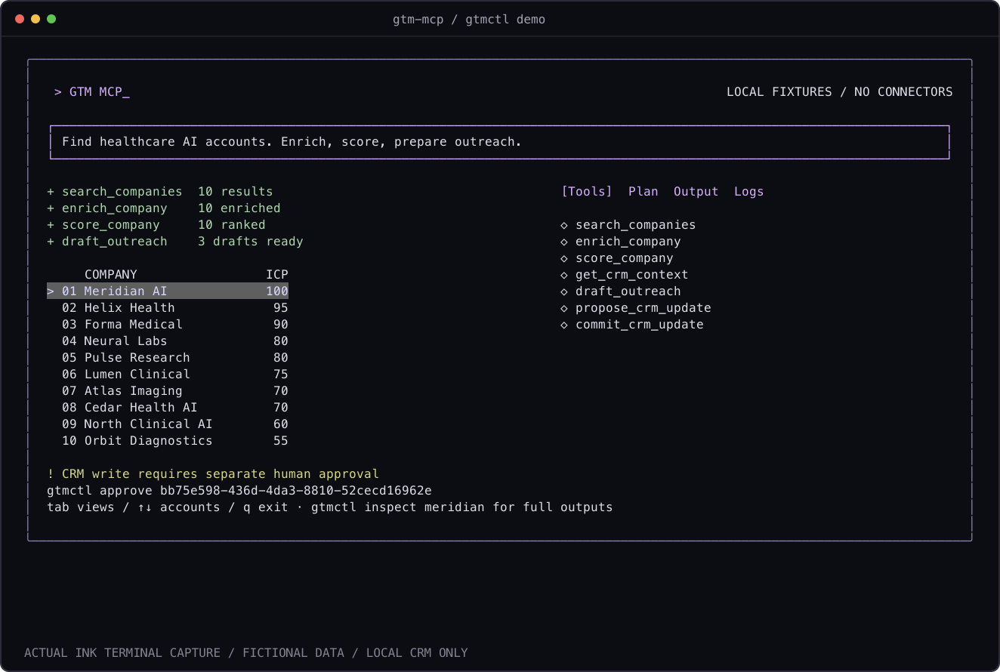

# GTM MCP_

**Research. Qualify. Prepare. Ask before writing.**

A terminal-native MCP server for B2B account workflows. Seven tools, inspectable JSON, explainable ICP scoring, and an explicit human boundary around CRM writes.



**Local-first v0.1:** real MCP transport and executable workflows; fictional account fixtures and a local JSON CRM. No HubSpot, Salesforce, LinkedIn, web-search, or LLM connections. Nothing sends email. The screenshot is a capture of the running terminal, not a product mockup.

## Start

Requires Node.js 22+ and npm. In this project directory:

```sh
npm ci
npm run build
npm link
gtmctl demo
```

No API keys. No global install needed if you prefer `node dist/cli.js demo`.
This package has not been published to npm; do not use `npx gtm-mcp` expecting this build.

The demo executes search, enrichment, scoring, three outreach drafts, and a pending CRM proposal. Tab switches Tools / Plan / Output / Logs; arrows select an account; Q exits. Trace pacing is for readability, not simulated network latency. Narrow terminals stack the panes. Redirected output uses plain structured JSON (`demo --plain` also works).

## Commands

```sh
gtmctl tools
gtmctl inspect meridian
gtmctl serve --stdio
gtmctl logs
gtmctl call search_companies '{"query":"healthcare AI","limit":10}'
gtmctl call draft_outreach '{"companyId":"meridian","offer":"qualification automation"}'
gtmctl call propose_crm_update '{"companyId":"meridian","status":"qualified","note":"ICP reviewed"}'
gtmctl approve <proposal-id>
gtmctl reject <proposal-id>
gtmctl commit <proposal-id>
```

`approve` displays the exact payload, SHA-256 digest, expiry, and base CRM version. It requires a real terminal and typing `approve <proposal-id>`. There is no MCP approval tool and no `approved: true` argument. Approval does not itself commit; the agent or operator must separately commit. Rejected, expired, modified, stale and replayed proposals fail closed. Proposals expire after 15 minutes.

## MCP Client Configuration

Use absolute paths, especially when Node is installed with nvm. For clients accepting an `mcpServers` config:

```json
{
  "mcpServers": {
    "gtm": {
      "command": "/absolute/path/to/node",
      "args": ["/absolute/path/to/gtm-mcp/dist/cli.js", "serve", "--stdio"],
      "env": { "GTM_HOME": "/absolute/path/to/private/gtm-state" }
    }
  }
}
```

Use the same `GTM_HOME` in your approval terminal. Stdout is reserved for MCP JSON-RPC; errors go to stderr. See the [official MCP TypeScript SDK stdio documentation](https://ts.sdk.modelcontextprotocol.io/server).

## Tools

| Tool                 | Input                   | Output / side effect                                             |
| -------------------- | ----------------------- | ---------------------------------------------------------------- |
| `search_companies`   | query, limit 1-10       | AND-token matching of name, industry, region; fictional accounts |
| `enrich_company`     | companyId               | fixture firmographics, signals, provenance                       |
| `score_company`      | companyId               | 0-100 score and every criterion                                  |
| `get_crm_context`    | companyId               | local record or null                                             |
| `draft_outreach`     | companyId, offer        | deterministic template; never sent                               |
| `propose_crm_update` | companyId, status, note | immutable pending proposal                                       |
| `commit_crm_update`  | proposalId              | approved local write; increments version                         |

The SDK validates Zod inputs; the engine validates again. Successful calls return both MCP `structuredContent` and human-readable JSON. Tool failures return MCP `isError`. Local logs retain the latest 500 successful tool outputs and human decisions; protocol/validation failures are returned to the caller, not silently treated as success.

## Explainable Scoring

Policy `healthcare-v1`, additive, no model inference:

| Criterion                  | Points |
| -------------------------- | -----: |
| Healthcare AI industry     |     30 |
| 20-250 employees inclusive |     25 |
| US or Canada               |     20 |
| Seed or Series A           |     15 |
| Hiring signal              |      5 |
| API signal                 |      5 |

Each criterion either earns its full points or zero. Meridian scores 100, Helix 95. These are fixture scores, not real-world predictive accuracy. Change the policy in `src/data.ts` and its boundary tests together.

## Architecture

```text
 AI client                     Human terminal
     | stdio JSON-RPC              | inspect / approve / reject
     v                             v
 Official MCP SDK -> Zod -> Engine <- gtmctl / Ink
                             |
            +----------------+----------------+
            |                |                |
       fixture search    scoring policy   draft templates
                             |
                  pending payload + digest
                             |
                  HUMAN terminal decision
                             |
                version / expiry / replay checks
                             |
                    atomic local JSON CRM
```

`src/tools.ts` is the shared application layer. Both MCP and CLI call it. `src/store.ts` uses exclusive directory locking and same-directory rename to prevent concurrent lost updates. Store directory mode 0700; newly written files 0600. Default state: `~/.gtm-mcp/state.json`; override `GTM_HOME` for isolated demos. A busy store returns a retryable error rather than racing. A crash can leave `write.lock`; only remove it after confirming no writer is running. Corrupt state fails rather than being reset.

## Trust Boundary / Limitations

This is a single-user local tool, not a hardened multi-tenant CRM service. The approval boundary protects against an MCP-only client, **not** an agent with shell access, PTY control, or write access to the same state directory. Never grant an untrusted agent those capabilities. For stronger isolation, run approval and state ownership under a separate OS identity or external authorization service. There are no remote connectors, authentication service, encryption at rest, backups, arbitrary natural-language planner, or delivery guarantees in this release. Data and drafts are stored locally in cleartext. Do not import confidential records without reviewing storage policy.

Real connectors should be explicit adapters with provenance, timeouts, rate limits, secret handling, and contract tests. Preserve the proposal/approval/commit boundary; never swap the fixture CRM for a remote write inside enrichment.

## Verify / Share

```sh
npm test
node scripts/capture.mjs
asciinema play docs/demo.cast
```

Tests cover schemas, score boundaries, fixture search, approval denial, rejection, expiry, payload tampering, stale versions, replay, piped approval rejection, real PTY human approval, narrow-terminal keyboard navigation, and an official MCP client/server stdio round trip across all seven tools. Capture uses `node-pty`, a temporary store, and the real Ink process. `docs/demo.cast` is a short terminal recording; `docs/terminal.png` is rasterized from its terminal cells. No real CRM data appears. The capture script repairs a missing executable bit in the macOS node-pty helper when needed.

The portfolio showcase is local-only in the parent website. This folder is independently installable and MIT licensed; no public GitHub repository or npm release is implied.

## Contributing

Open an issue describing the workflow and trust boundary before adding a connector. Keep outputs deterministic in fixture mode. Add tests for failure paths and schema changes, run `npm test`, and never include credentials or customer records in fixtures or screenshots.
